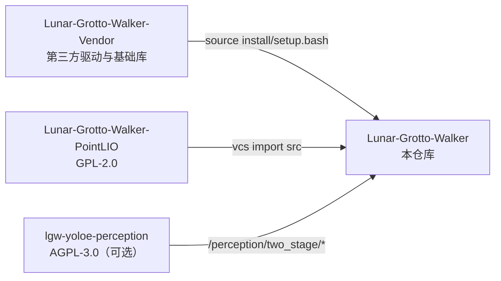

# Lunar-Grotto-Walker

**月窟行者** —— 面向月球熔岩洞环境的四足机器人智能自主采样系统。

[](https://github.com/Lunar-Grotto-Walker-Team/Lunar-Grotto-Walker/actions/workflows/c-cpp-ci.yml)
[](https://github.com/Lunar-Grotto-Walker-Team/Lunar-Grotto-Walker/actions/workflows/python-ci.yml)

---

## 简介

本项目以 **Unitree Go2 + AgileX Piper 机械臂**为平台，构建一条
「感知 → 建图/定位 → 地形通行性导航 → 目标观察与抓取」的自主作业链路，重点解决：

- 熔岩洞内**无 GPS、弱光、点云稀疏**条件下的定位与建图；
- 崎岖地形下的**可通行性评估与路径规划**；
- 双相机（头部 + 臂端）下的**目标发现、抵近观察与抓取**；
- 以上能力通过**行为树**统一编排，便于任务级复用与现场调整。

> 状态：开发中。实机验证记录见 [`docs/`](docs/)，行为树设计见 [`docs/bt/`](docs/bt/README.md)。

## 能力概览

| 能力 | 实现 | 位置 |
|---|---|---|
| LiDAR-惯性里程计 | Point-LIO（独立仓库，GPL-2.0） | `deps.repos` |
| 回环检测 | simple_loop_closure | `src/simple_loop_closure_ros2` |
| 高程图与地形通行性 | 6 个 terrain 包 + Nav2 costmap 插件 | `src/terrain/` |
| 导航 | Nav2（FollowPath / Spin）+ 两点行走服务 | `src/go2_transit` |
| 行为树编排 | BehaviorTree.CPP 4.9.1 + BT.ROS2 v0.3.0 | `src/lgw_bt_planner` |
| 机械臂控制 | MoveIt 2 + MoveIt Servo + ros2_control | `src/lgw_bt_planner`、vendor `agx_arm_ros` |
| 双相机 3D 跟踪 | 统一目标注册与跟踪 | `src/lgw_3d_tracker` |
| 视觉感知（可选） | YOLOE 两阶段 RGB-D 检测 | 独立仓库（见「依赖关系」） |

## 目录结构

```
Lunar-Grotto-Walker/
├── src/                        # ROS 2 功能包（colcon build 根）
│   ├── lgw_bt_planner/         # 行为树引擎、35 个 BT 节点、servo_node、42 个 gtest
│   ├── lgw_3d_tracker/         # 头/臂双相机统一 3D 跟踪
│   ├── go2_transit/            # 两点直线行走 / 原地转向（TransitToLocalPoint）
│   ├── pointlio_cloud_relay/   # 点云转 base_footprint，供 Nav2 costmap
│   ├── body_pose_bridge/       # Go2 姿态服务 /set_body_pose
│   ├── lgw_vui_bridge/         # VUI 亮度服务（Unitree SDK 子进程隔离）
│   ├── agx_topic_hardware/     # ros2_control 硬件插件（topic 后端）
│   ├── lgw_servo_smoothing/    # MoveIt Servo 平滑插件
│   ├── servo_state_probe/      # MoveIt 状态探针（诊断）
│   ├── yoloe_interfaces/       # 感知与跟踪接口定义
│   ├── simple_loop_closure_ros2/
│   └── terrain/                # 高程图 / 通行性 / 地形补全（6 个包）
├── tools/
│   ├── ci/validate_repo.py     # 仓库结构与配置校验（CI）
│   └── lgw/                    # 现场启动、录制、标定、诊断脚本
├── docs/                       # 依赖说明、行为树架构、专题记录
├── deps.repos                  # Point-LIO（GPL-2.0）版本固定
└── .github/                    # CI 与 Issue/PR 模板
```

## 硬件与软件环境

| 项 | 说明 |
|---|---|
| 机器人 | Unitree Go2 |
| 计算单元 | NVIDIA Jetson Orin NX 16 GB（JetPack R35.5.1） |
| 机械臂 | AgileX Piper（CAN 1 Mbps） |
| 相机 | 头部 / 臂端 RealSense（D435i / D435） |
| LiDAR | Go2 自带 Unitree L1/L2；导航链可选 Livox Mid-360S |
| 宿主机 | Ubuntu 20.04 + ROS 2 Foxy（感知推理进程运行于此） |
| 运行环境 | Docker 容器：Ubuntu 22.04 + ROS 2 Humble |
| 关键软件 | MoveIt 2、Nav2、ros2_control、BehaviorTree.CPP 4.9.1、BT.ROS2 v0.3.0 |

## 依赖关系

本仓库是**应用层**，需与另外两个仓库配套使用：



| 依赖 | 获取方式 | 说明 |
|---|---|---|
| **Vendor**（驱动 / 基础库） | 单独 clone 并构建，`source` 其 `install/setup.bash` | **不是**本仓库的依赖项，见下文 |
| **Point-LIO** | `vcs import src < deps.repos` | GPL-2.0，单独仓库（许可隔离） |
| **感知链路（YOLOE）** | 独立仓库，可选 | 缺失时依赖检测结果的 BT 子树会失败 |
| Python：`pyAgxArm` | `pip install "git+https://github.com/agilexrobotics/pyAgxArm.git"` | 机械臂 CAN SDK（1.0.0） |
| `unitree_sdk2`（C++） | 宿主机已有的 SDK 源码树 | `lgw_vui_bridge` 构建需要，见 `docs/dependencies.md §3.3` |

完整清单（apt / vendor / pip / SDK 与 `/usr/local` 安装步骤）见
**[docs/dependencies.md](docs/dependencies.md)**。

## 快速部署

### 1. 系统依赖

```bash
sudo apt install ros-humble-gtsam ros-humble-pcl-ros ros-humble-tf2-eigen \
                 ros-humble-message-filters ros-humble-moveit ros-humble-navigation2 \
                 ros-humble-ros2-control ros-humble-ros2-controllers \
                 ros-humble-behaviortree-cpp ros-humble-rosbag2 nlohmann-json3-dev \
                 can-utils python3-numpy python3-scipy \
                 libpcl-dev libeigen3-dev libboost-all-dev
```

### 2. 部署 vendor（环境层）

```bash
git clone https://github.com/Lunar-Grotto-Walker-Team/Lunar-Grotto-Walker-Vendor.git
cd Lunar-Grotto-Walker-Vendor
vcs import src < deps.repos
vcs import src/agx_arm_ros/src/agx_arm_description < deps.agx-arm-urdf.repos
pip install "git+https://github.com/agilexrobotics/pyAgxArm.git"
# SDK 层（Livox-SDK2 / librealsense / kindr）先 make install，见 vendor/src/README.md
colcon build --symlink-install --parallel-workers 4
source install/setup.bash
```

> vendor 里的 `unitree_sdk2` **不随仓库分发**。构建 `lgw_vui_bridge` 前，把宿主机
> 已编译的 SDK 路径通过 `UNITREE_SDK2_DIR` 指过来；其余依赖见 vendor README。

### 3. 构建本仓库

```bash
git clone https://github.com/Lunar-Grotto-Walker-Team/Lunar-Grotto-Walker.git
cd Lunar-Grotto-Walker

source ../Lunar-Grotto-Walker-Vendor/install/setup.bash   # ← 缺这句编译会失败
vcs import src < deps.repos                               # 拉取 Point-LIO
python3 tools/preflight_deps.py                           # 检查环境是否就绪
colcon build --symlink-install --parallel-workers 4
source install/setup.bash
```

### 4. 运行行为树

```bash
# 终端 1：机械臂驱动（CAN + agx_arm_ctrl）
bash tools/lgw/start/start_lgw_arm.sh --driver-only

# 终端 2：MoveIt / Servo / tracker / BT 主链路
bash tools/lgw/start/start_lgw_chain.sh use_bt:=true follow:=true

# 终端 3：触发一棵树
bash tools/lgw/start/run_bt.sh PickAndPlaceDemo
```

脚本的路径约定（容器、挂载点、`WS_FORK_CT` 覆盖）见
[tools/lgw/README.md](tools/lgw/README.md)。

## 测试与 CI

```bash
# 仓库结构与配置校验（与 CI 相同）
python3 tools/ci/validate_repo.py
python -m compileall -q src tools && ruff check .

# 单元测试（需要 vendor + MoveIt 环境，在 Jetson 容器内）
colcon test --packages-select lgw_bt_planner go2_transit
```

**CI 不编译**：本仓库依赖 Jetson 侧 vendor 包（`unitree_go`、`livox_ros_driver2`），
GitHub 托管 runner 上无法安装。CI 只做结构、YAML 与 Python 静态检查；真正的
`colcon build` / `colcon test` 在 Jetson 上执行。

## 文档

| 文档 | 内容 |
|---|---|
| [docs/dependencies.md](docs/dependencies.md) | 依赖清单、部署顺序、环境变量、`/usr/local` SDK |
| [docs/bt/](docs/bt/README.md) | 行为树架构、35 个节点、22 棵树、端点契约与历史记录 |
| [docs/slam/](docs/slam/) | 建图与定位相关记录 |
| [docs/project/](docs/project/) | Git Flow、协作规范 |
| [tools/lgw/README.md](tools/lgw/README.md) | 现场启动、录制与诊断脚本 |

## 开发流程

采用 **Git Flow**：

```
feature/<issue-id>-<desc>  →  develop（1 人 review）  →  main（2 人 review）
hotfix/x.y.z               →  main + develop
```

分支命名、PR 模板与评审要求见 [Git Flow 指南](docs/project/Git-Flow-Guide.md)。
提交信息使用 Conventional Commits（`feat:` / `fix:` / `docs:` / `chore:` …）。

## 许可证与第三方组件

- **团队自写包**：Apache-2.0（各 `package.xml` 内声明）；
- `src/simple_loop_closure_ros2`：BSD-3-Clause（保留上游声明）；
- **Point-LIO**：GPL-2.0，仅存在于独立仓库，通过 `deps.repos` 引用；
- **感知链路**：AGPL-3.0，独立仓库；
- vendor 内第三方组件的许可与改动记录见各子目录 `UPSTREAM.md` 与 vendor 仓库 `NOTICE`。

分发或闭源交付前，请按 [docs/dependencies.md](docs/dependencies.md) 逐项确认许可边界。

## 致谢

- [Unitree Robotics](https://www.unitree.com/) —— Go2 平台与 SDK
- [AgileX Robotics](https://github.com/agilexrobotics) —— Piper 机械臂驱动与 pyAgxArm
- [BehaviorTree.CPP](https://github.com/BehaviorTree/BehaviorTree.CPP) / [BehaviorTree.ROS2](https://github.com/BehaviorTree/BehaviorTree.ROS2)
- [Point-LIO](https://github.com/hku-mars/Point-LIO) 及本仓库使用的其他开源项目
